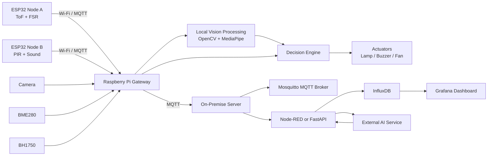
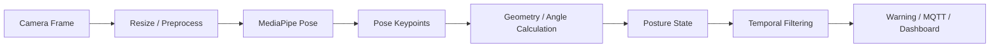
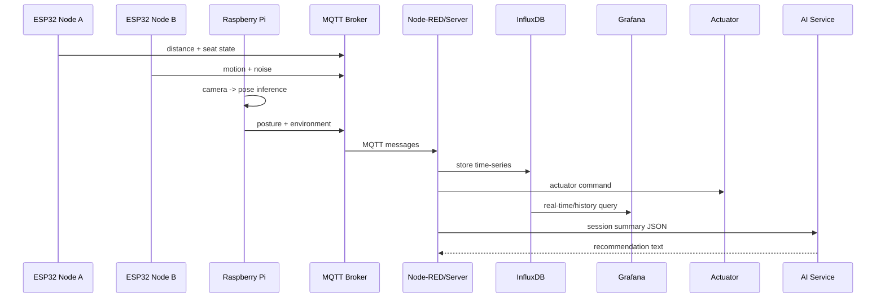

# FocusGuard — Privacy-Aware Smart Study Desk
## IoT Systems and Digital Solutions Term Project — Team Design Document

> **Project concept:** A privacy-aware smart study desk that combines distributed IoT sensors, on-device computer vision, automated environmental control, MQTT messaging, time-series storage, dashboarding, and an AI service to improve study ergonomics and desk conditions without continuously uploading raw video to the cloud.

---

## 1. Project Overview

### 1.1 Project Name
**FocusGuard — Privacy-Aware Smart Study Desk**

### 1.2 One-Sentence Pitch
FocusGuard monitors posture, viewing distance, sitting duration, lighting, noise, and environmental conditions in real time, then provides context-aware feedback and automatically controls desk devices while keeping camera processing local for privacy.

### 1.3 Core Idea
The project is not intended to claim that a camera can directly measure a person's mental focus. Instead, it measures observable and defensible factors that affect a study session:

- Ergonomic posture
- Viewing distance
- Continuous sitting duration
- Ambient lighting
- Ambient noise
- Temperature and humidity
- Desk occupancy / presence

These measurements are combined into a **Study Condition Score** and used to trigger useful actions such as:

- Posture warning
- Too-close warning
- Break reminder
- Automatic desk lamp control
- Optional fan control
- Session logging
- AI-generated session summary

---

# 2. Problem Statement

Students and office workers can spend long periods at a desk while gradually developing poor posture, sitting too close to a screen, studying under unsuitable lighting, remaining seated for too long, or working in noisy or uncomfortable environments.

Most ordinary desks cannot:

1. Understand whether a user is present.
2. Detect poor posture.
3. Detect unsafe or undesirable viewing distance.
4. Monitor environmental conditions.
5. Automatically respond to poor conditions.
6. Provide historical feedback about study behavior.
7. Preserve privacy while using camera-based sensing.

**FocusGuard** addresses this problem with a distributed embedded IoT system that monitors both the user and the study environment, makes decisions locally, controls physical devices, and records time-series data for later analysis.

---

# 3. Project Objectives

The project should:

1. Detect whether a user is currently using the desk.
2. Detect posture using a camera and a pretrained computer-vision model.
3. Measure approximate user-to-desk/screen distance.
4. Monitor sitting duration and provide break reminders.
5. Monitor lighting, noise, temperature, and humidity.
6. Automatically control at least one physical actuator.
7. Use MQTT as the communication layer between distributed IoT components.
8. Store historical IoT data in a time-series database.
9. Display real-time and historical information on a dashboard.
10. Use an external AI service for session-level interpretation or recommendation.
11. Keep raw camera video local by default.
12. Quantitatively evaluate vision performance, FPS, sensor accuracy, and system latency.
13. Demonstrate both successful and unsuccessful cases.

---

# 4. Design Principles

## 4.1 Privacy First
Camera frames should be processed locally on the Raspberry Pi whenever possible.

Default behavior:

```text
Camera
  ↓
Local Pose Estimation
  ↓
Derived numerical / categorical features
  ↓
MQTT / Database / Dashboard
```

Only metadata such as the following should leave the local vision pipeline:

```json
{
  "person_detected": true,
  "posture": "SLOUCH",
  "confidence": 0.91,
  "fps": 17.8
}
```

Raw face/video upload should not be required for normal operation.

---

## 4.2 Edge-First Operation
Core functions should continue to work even if an external AI service or cloud connection fails.

Core functions that should remain local:

- Sensor acquisition
- Pose detection
- Posture classification
- Distance monitoring
- Break timing
- Lighting control
- Buzzer warnings
- MQTT communication within the local network
- Database logging if hosted locally

The AI service is an enhancement, not a critical dependency.

---

## 4.3 Explainable Logic
For the MVP, major decisions should be based on clear rules rather than a black-box model.

Example:

```text
IF person_present = TRUE
AND posture = SLOUCH
AND slouch_duration > 30 seconds
THEN trigger posture warning
```

This makes the system easy to explain, debug, evaluate, and demonstrate.

---

# 5. High-Level System Architecture



---

# 6. Physical Architecture

## 6.1 Sensor Node A — User Interaction Node

**Platform:** ESP32

### Sensors
1. **VL53L0X / VL53L1X Time-of-Flight Sensor**
   - Interface: I2C
   - Purpose: Estimate user-to-desk/screen distance.
   - Typical use: Detect when the user leans too close.

2. **FSR (Force Sensitive Resistor)**
   - Interface: Analog
   - Purpose: Detect whether the chair/seat is occupied.
   - Typical use: Start/pause study session and measure sitting duration.

### Example output

```json
{
  "distance_cm": 52.4,
  "seat_pressure": 718,
  "seat_occupied": true
}
```

---

## 6.2 Sensor Node B — Local Environment Node

**Platform:** ESP32

### Sensors
3. **PIR Motion Sensor**
   - Interface: Digital
   - Purpose: Detect movement/presence around the desk.

4. **Sound Sensor / Microphone Level Module**
   - Interface: Analog or digital depending on module
   - Purpose: Estimate relative noise level.
   - Privacy note: Prefer amplitude/noise-level features instead of recording speech.

### Example output

```json
{
  "motion": true,
  "noise_level": 0.31,
  "noise_state": "QUIET"
}
```

---

## 6.3 Raspberry Pi Gateway

**Platform:** Raspberry Pi

### Gateway Sensors
5. **BME280**
   - Interface: I2C
   - Measures:
     - Temperature
     - Humidity
     - Pressure
   - Main purpose: Environmental comfort monitoring.

6. **BH1750**
   - Interface: I2C
   - Measures:
     - Ambient illumination in lux
   - Main purpose: Adaptive desk-light control.

### Camera
7. **Raspberry Pi Camera or USB Webcam**
   - Purpose:
     - Person detection
     - Pose keypoint extraction
     - Posture classification
     - Optional head-direction estimation

---

# 7. Actuators

At least one actuator is required. The recommended design includes more than one because they are inexpensive and make the demo more interactive.

## 7.1 Smart Desk Lamp — Recommended Main Actuator

Possible hardware:

- LED strip
- LED desk lamp
- MOSFET driver or relay module

Example logic:

```text
IF person_present
AND ambient_lux < LIGHT_THRESHOLD
THEN lamp = ON
```

Optional PWM version:

```text
Very dark    → 100% brightness
Moderate     → 50–70%
Bright       → OFF
```

---

## 7.2 Buzzer — Recommended

Used for:

- Posture warning
- Too-close warning
- Break reminder

Example:

```text
IF slouch_duration > 30 seconds
THEN short buzzer beep
```

The warning should not trigger continuously every frame. A cooldown should be implemented.

---

## 7.3 Mini Fan — Optional

Used when:

```text
person_present = TRUE
AND temperature > configured threshold
```

This is a useful stretch feature but is not required for the MVP if the lamp and buzzer are already implemented.

---

# 8. Core Features

## 8.1 Automatic Desk Occupancy Detection

Combine multiple signals:

```text
FSR seat occupied
+
PIR motion
+
Camera person detected
```

Possible states:

- `EMPTY`
- `USER_PRESENT`
- `TEMPORARILY_AWAY`

This is more reliable than using only a single sensor.

### Example rule

```text
IF FSR = occupied
AND camera sees person
THEN session_state = ACTIVE
```

If no person is detected for several minutes:

```text
session_state = PAUSED
```

---

# 9. Posture Monitoring

## 9.1 Computer Vision Model
Recommended:

- **MediaPipe Pose / Pose Landmarker**

Alternative:

- Lightweight pretrained pose model

MediaPipe is preferred for the first implementation because it is lightweight and does not require training a new deep-learning model from scratch.

---

## 9.2 Pose Pipeline



---

## 9.3 Possible Posture States

MVP:

- `GOOD`
- `SLOUCH`
- `LEAN_FORWARD`
- `LEAN_LEFT_RIGHT`
- `NO_PERSON`

Do not add too many posture classes initially.

---

## 9.4 Example Geometric Features

Potential landmarks:

- Nose
- Ear
- Shoulder
- Hip

Potential measurements:

- Head/neck forward angle
- Shoulder alignment
- Torso inclination
- Horizontal leaning
- Relative nose-to-shoulder displacement

Example conceptual angle:

\[
\theta_{neck} = \angle(\text{ear}, \text{shoulder}, \text{vertical})
\]

The exact threshold should be experimentally calibrated rather than claimed to be medically universal.

---

## 9.5 Temporal Filtering

Do not warn from one bad frame.

Example:

```text
Frame 1: SLOUCH
Frame 2: GOOD
Frame 3: SLOUCH
```

should not immediately trigger an alert.

Recommended logic:

```text
Posture must remain abnormal
for N consecutive frames
or T seconds
before warning.
```

Example:

```text
SLOUCH continuously > 30 seconds
→ POSTURE_WARNING
```

For the presentation demo, the duration can be shortened.

---

# 10. Viewing-Distance Monitoring

Use ToF distance as a physical measurement.

Example:

```text
Distance = 52 cm → NORMAL
Distance = 33 cm → TOO_CLOSE
```

For stronger confidence, fuse the ToF reading with the camera posture result:

```text
Camera: LEAN_FORWARD
AND
ToF: distance below threshold
        ↓
High-confidence TOO_CLOSE warning
```

This is one of the key examples of **multimodal sensor fusion** in the project.

---

# 11. Sitting Duration and Break Reminder

## 11.1 Session Start

Possible start condition:

```text
FSR occupied
AND
person detected
```

Then:

```text
session_timer = START
```

---

## 11.2 Pause

If the user leaves:

```text
FSR not occupied
AND
no person detected
```

then:

```text
session_timer = PAUSE
```

---

## 11.3 Break Reminder

Example rule:

```text
continuous_sitting > configured_limit
→ break reminder
```

The demo can use a short interval such as 20–30 seconds, while the real configuration can use a longer value.

---

# 12. Eye-Break Assistant

Optional ergonomic feature inspired by the concept of periodically looking away from a near screen.

The project should not claim to verify eye health. It simply provides a configurable screen-break reminder.

Possible logic:

```text
session active
+
person present
+
continuous desk use above interval
→ eye-break reminder
```

This feature is easy to implement after the session timer already exists.

---

# 13. Adaptive Smart Lighting

Input:

- BH1750 lux
- User presence
- Session state

Output:

- Desk lamp

Example:

```text
IF session_active = TRUE
AND lux < lower_threshold
THEN lamp ON
```

Optional multiple levels:

```text
0–100 lux      → 100%
100–250 lux    → 70%
250–400 lux    → 30%
>400 lux       → OFF
```

Exact thresholds should be treated as configurable project parameters.

---

# 14. Noise Monitoring

The sound sensor should be used for relative environmental-noise monitoring.

Possible states:

- `QUIET`
- `MODERATE`
- `NOISY`

Example:

```text
noise level above threshold
for > 10 seconds
→ NOISE_WARNING
```

Important privacy design:

- Do not store raw audio unless explicitly required.
- Prefer only amplitude / derived noise level.
- Do not perform speech recognition for this feature.

---

# 15. Thermal Comfort Monitoring

Input:

- Temperature
- Humidity

Possible output:

- Environment status
- Optional fan control

Example:

```text
IF user_present
AND temperature > TEMP_THRESHOLD
THEN fan ON
```

This can also be included in the Study Condition Score.

---

# 16. Study Condition Score

A signature feature that turns many sensor values into one understandable metric.

## 16.1 Proposed Variables

Let:

- \(L\) = lighting suitability
- \(N\) = noise suitability
- \(T\) = thermal comfort
- \(P\) = posture quality
- \(D\) = viewing-distance suitability

Normalize each to:

\[
0 \leq x \leq 1
\]

Then compute:

\[
S = 100(w_L L + w_N N + w_T T + w_P P + w_D D)
\]

with:

\[
w_L + w_N + w_T + w_P + w_D = 1
\]

Example initial weights:

\[
w_L=0.15,\quad
w_N=0.15,\quad
w_T=0.15,\quad
w_P=0.30,\quad
w_D=0.25
\]

These are starting values only and can be adjusted after testing.

---

## 16.2 Score Example

```text
Lighting       92
Noise          70
Temperature    90
Posture        85
Distance       96

Study Condition Score = 86/100
Status = GOOD
```

Suggested interpretation:

```text
80–100  GOOD
60–79   FAIR
0–59    NEEDS ATTENTION
```

Again, this is a project-defined engineering score, not a clinical health score.

---

# 17. Context-Aware Warnings

Avoid noisy alerts by considering multiple signals.

### Example 1 — Posture

```text
Camera detects SLOUCH
+
duration > 30 sec
+
seat occupied
→ posture warning
```

### Example 2 — Too Close

```text
ToF distance low
+
camera detects LEAN_FORWARD
→ too-close warning
```

### Example 3 — Lighting

```text
user present
+
lux too low
→ lamp ON
```

### Example 4 — Empty Desk

```text
no person
+
FSR empty
+
PIR inactive
→ lamp OFF
```

---

# 18. Computer Vision Output Must Affect System Behavior

This is a critical requirement.

The system should clearly demonstrate:

```text
Camera
  ↓
Pose model
  ↓
SLOUCH detected
  ↓
Decision engine
  ↓
Buzzer / LED warning
```

and/or:

```text
Camera detects no person
+
other occupancy sensors agree
  ↓
Lamp OFF
```

This establishes a direct connection between image processing and physical system behavior.

---

# 19. AI Service Feature

The AI service should perform a different role from the local pose model.

## 19.1 Recommended Use: AI Session Summary

At the end of a session, send only structured statistics such as:

```json
{
  "session_minutes": 87,
  "study_condition_score": 82,
  "good_posture_percent": 72,
  "slouch_events": 5,
  "too_close_events": 3,
  "breaks": 2,
  "average_lux": 310,
  "noise_warning_minutes": 8,
  "average_temperature": 27.8
}
```

The AI service generates a concise summary such as:

```text
The desk environment was generally suitable.
Most posture warnings occurred during the final part of the session.
Consider taking a break earlier and improving posture consistency.
```

---

## 19.2 Candidate Services

Choose only one for the final implementation:

- AWS Bedrock
- OpenAI API
- Gemini API
- Another instructor-approved AI service

If alignment with the course content is important, AWS is a natural candidate because the syllabus includes an AWS workshop.

---

## 19.3 AI Service Failure Handling

If the external AI service fails:

```text
Core monitoring continues.
No actuator depends on the AI response.
Session statistics remain available in the dashboard.
```

---

# 20. MQTT Messaging Design

The project requires multiple MQTT topics for different IoT sources.

Recommended topic structure:

## 20.1 Node A

```text
focusguard/nodeA/user
```

Payload:

```json
{
  "device_id": "nodeA",
  "timestamp": "ISO8601",
  "distance_cm": 52.4,
  "seat_pressure": 718,
  "seat_occupied": true
}
```

Purpose:

- Viewing distance
- Seat occupancy

---

## 20.2 Node B

```text
focusguard/nodeB/environment
```

Payload:

```json
{
  "device_id": "nodeB",
  "timestamp": "ISO8601",
  "motion": true,
  "noise_level": 0.31,
  "noise_state": "QUIET"
}
```

Purpose:

- Motion / presence
- Noise monitoring

---

## 20.3 Gateway Environment

```text
focusguard/gateway/environment
```

Payload:

```json
{
  "temperature_c": 27.4,
  "humidity_percent": 64.0,
  "pressure_hpa": 1009.8,
  "lux": 286.0
}
```

Purpose:

- Environmental conditions

---

## 20.4 Gateway Vision

```text
focusguard/gateway/vision
```

Payload:

```json
{
  "person_detected": true,
  "posture": "SLOUCH",
  "confidence": 0.91,
  "fps": 17.8
}
```

Purpose:

- Vision-derived user state

---

## 20.5 System Events

```text
focusguard/system/event
```

Payload:

```json
{
  "event_type": "POSTURE_WARNING",
  "severity": "MEDIUM",
  "timestamp": "ISO8601"
}
```

Purpose:

- Important system events
- Warning history

---

## 20.6 Actuator Commands / States

```text
focusguard/actuator
```

Payload:

```json
{
  "lamp_percent": 70,
  "fan": false,
  "buzzer": true
}
```

Purpose:

- Device control
- Device-state logging

---

# 21. Server Architecture

Recommended low-cost implementation:

```text
Laptop or Raspberry Pi Server
│
├── Mosquitto
│     MQTT broker
│
├── Node-RED
│     Messaging + rules + routing
│
├── InfluxDB
│     Time-series storage
│
└── Grafana
      Dashboard
```

Alternative:

```text
FastAPI
```

can replace or complement Node-RED if the team wants a code-first backend.

For fast development, **Node-RED is recommended for the MVP**.

---

# 22. Time-Series Database

Recommended:

**InfluxDB**

## 22.1 Suggested Measurements

### `environment`

Fields:

```text
temperature
humidity
pressure
lux
noise_level
```

Tags:

```text
device_id
location
```

---

### `user_state`

Fields:

```text
distance_cm
seat_occupied
person_detected
posture
posture_confidence
```

---

### `system_state`

Fields:

```text
study_score
session_active
session_duration
lamp_state
fan_state
```

---

### `event`

Fields:

```text
event_type
severity
value
```

---

# 23. Dashboard Design

Recommended dashboard sections:

```text
┌──────────────────────────────────────────┐
│ FOCUSGUARD                    SESSION ON │
├────────────────┬─────────────────────────┤
│ STUDY SCORE    │      LIVE CAMERA        │
│                │                         │
│     84/100     │     Pose Overlay        │
│      GOOD      │                         │
├────────────────┼─────────────────────────┤
│ Posture        │ Viewing Distance        │
│ GOOD           │ 54 cm                   │
├────────────────┼─────────────────────────┤
│ Light          │ Noise                   │
│ 340 lux        │ QUIET                   │
├────────────────┼─────────────────────────┤
│ Temperature    │ Session                 │
│ 26.8°C         │ 42 min                  │
├──────────────────────────────────────────┤
│ Environmental History                    │
│              time-series plots           │
├──────────────────────────────────────────┤
│ Events                                   │
│ 10:34 Posture warning                    │
│ 10:51 Break reminder                     │
└──────────────────────────────────────────┘
```

---

## 23.1 Real-Time Panels

Show:

- Current posture
- Distance
- Lux
- Noise
- Temperature
- Humidity
- Occupancy
- Study Condition Score
- Lamp state
- Fan state
- Session duration

---

## 23.2 Historical Panels

Show:

- Posture over time
- Distance over time
- Lux history
- Noise history
- Temperature / humidity
- Study Condition Score
- Warning-event count
- Session duration

---

# 24. Session Timeline Feature

A useful advanced visualization:

```text
09:00 ───────────────────────────── 10:00

GOOD     ███████████████
SLOUCH                  ███
AWAY                        ███
GOOD                           █████
```

This can help explain when posture begins to degrade during a long session.

---

# 25. Posture Event Heatmap

Example:

```text
Hour      Warning Count
09–10     ██
10–11     █████
11–12     ████████
```

This is useful as historical data and presentation material.

---

# 26. Automatic Session Detection

No manual Start button is required for the MVP if sensor fusion works reliably.

### Start

```text
FSR occupied
+
camera person detected
→ START SESSION
```

### Pause

```text
seat empty
+
camera no person
→ PAUSE
```

### End

```text
inactive for configured time
→ END SESSION
```

---

# 27. Optional Advanced Feature: Adaptive Reminder

Instead of fixed reminders:

```text
IF posture remains good
AND user already took regular breaks
→ fewer warnings
```

If:

```text
slouch events increase
+
continuous sitting duration increases
→ reminder becomes earlier / more noticeable
```

This should only be attempted after the core system works.

---

# 28. Data Flow — End to End



---

# 29. Example System Scenario

## Scenario: User Gradually Slouches

1. FSR detects seat occupancy.
2. Camera detects a person.
3. Session begins.
4. BH1750 detects acceptable lighting.
5. User initially has GOOD posture.
6. After 30 minutes, user begins leaning forward.
7. MediaPipe repeatedly returns forward-lean landmarks.
8. ToF distance also drops below the configured threshold.
9. Decision engine identifies high-confidence `TOO_CLOSE / LEAN_FORWARD`.
10. Buzzer gives a short warning.
11. MQTT event is published.
12. Event is stored in InfluxDB.
13. Grafana updates the event timeline.
14. At the end of the session, statistics are sent to the AI service.
15. AI generates a short session summary.

---

# 30. Quantitative Evaluation Plan

The project rubric requires quantitative evaluation, including FPS and accuracy.

## 30.1 Pose / Posture Classification

Prepare controlled test cases.

Example dataset:

| Class | Planned Samples |
|---|---:|
| GOOD | 30 |
| SLOUCH | 30 |
| LEAN_FORWARD | 30 |
| LEAN_LEFT_RIGHT | 30 |
| NO_PERSON | 30 |

Calculate:

\[
Accuracy = \frac{\text{Correct Predictions}}{\text{Total Predictions}}
\]

Also report when possible:

- Precision
- Recall
- F1-score
- Confusion matrix

---

## 30.2 FPS

Measure actual inference performance on the Raspberry Pi.

\[
FPS = \frac{\text{Processed Frames}}{\text{Elapsed Time}}
\]

Report:

- Average FPS
- Minimum / maximum if useful
- Camera resolution
- Inference configuration

Do not use only a model specification or laptop FPS.

---

## 30.3 ToF Distance Sensor Accuracy

Reference distances:

```text
30 cm
40 cm
50 cm
60 cm
70 cm
```

Measure multiple trials.

Calculate:

\[
MAE =
\frac{1}{N}
\sum_{i=1}^{N}|d_i-\hat d_i|
\]

where:

- \(d_i\) = reference distance
- \(\hat d_i\) = sensor reading

---

## 30.4 End-to-End Response Latency

For example:

```text
Posture violation occurs
↓
Computer vision detects it
↓
MQTT / decision engine
↓
Buzzer activates
```

Measure:

\[
Latency =
t_{\text{actuation}}
-
t_{\text{detection}}
\]

Potential metrics:

- Mean latency
- Standard deviation
- 95th percentile if enough trials are collected

---

# 31. Qualitative Evaluation Plan

The rubric also requires successful and unsuccessful cases.

Suggested test conditions:

| Case | Expected Behavior |
|---|---|
| Good posture, normal light | No warning |
| Clear slouch | Posture warning |
| User leans very close | Too-close warning |
| Empty chair | No posture alert |
| Dark room | Lamp turns on |
| Bright room | Lamp turns off |
| Loud environment | Noise status changes |
| Low camera light | Vision confidence may drop |
| Body partially occluded | Possible classification failure |
| Camera moved from calibrated position | Geometry may degrade |
| Two people visible | Ambiguous case / limitation |

Show both:

- Correct examples
- Failure examples

This will strengthen the limitations discussion.

---

# 32. Failure Handling

## 32.1 Camera Failure

If camera input disappears:

```text
vision_available = false
```

System still retains:

- FSR occupancy
- ToF distance
- PIR
- Light
- Temperature/humidity
- Noise

Dashboard should show:

```text
VISION OFFLINE
```

---

## 32.2 Network Failure

ESP32 may:

- Reconnect automatically
- Buffer only minimal state if implemented
- Continue local sampling

Core gateway logic should not depend on Internet access.

---

## 32.3 AI Service Failure

The system should:

- Store session statistics
- Skip AI summary
- Continue all core functions

---

# 33. Privacy and Security Considerations

## Privacy

Recommended:

- Process video locally.
- Do not upload continuous video.
- Do not record audio conversations.
- Store only derived noise level.
- Store only pose metadata by default.
- Make image/video recording optional.

## Network / IoT Security

Recommended if time allows:

- MQTT username/password
- Separate Wi-Fi / local network
- Restrict dashboard access
- Avoid exposing MQTT broker directly to the public Internet

These are secondary to the core project but useful for the presentation.

---

# 34. SDG Mapping

The final presentation requires 2–3 SDGs.

Potential mapping:

## SDG 3 — Good Health and Well-Being
FocusGuard promotes healthier study habits through posture awareness, break reminders, and environmental monitoring.

## SDG 4 — Quality Education
The system aims to improve the physical study environment and provides users with feedback about their study sessions.

## SDG 9 — Industry, Innovation and Infrastructure
The project demonstrates embedded sensing, edge AI, IoT messaging, and data-driven automation in a connected system.

Do not overclaim medical outcomes.

---

# 35. Strengths

1. **Practical**
   - Can be used on a normal desk.
2. **Low-cost**
   - Uses common ESP32 and hobby sensors.
3. **Good demo visibility**
   - Physical actuator responses are easy to show.
4. **Privacy-aware**
   - Raw camera data remains local by default.
5. **Distributed IoT architecture**
   - Multiple sensor nodes and a gateway.
6. **Multimodal sensor fusion**
   - Camera + ToF + FSR + PIR + environment.
7. **Edge-first operation**
   - Core features work without cloud AI.
8. **Clear evaluation**
   - Accuracy, FPS, distance MAE, and response latency can be measured.
9. **Complete historical data**
   - Time-series database and dashboard.
10. **Expandable**
    - Additional sensors or personalization can be added later.

---

# 36. Limitations

1. Posture estimation depends on camera placement.
2. Low lighting can reduce pose-estimation reliability.
3. Partial occlusion may cause missing keypoints.
4. Fixed posture thresholds may not suit every user.
5. ToF measures physical distance, not actual eye-to-screen distance perfectly.
6. PIR may fail when a seated user is very still.
7. Sound sensor values may not correspond directly to calibrated dB unless a calibrated microphone is used.
8. Environmental recommendations are not medical advice.
9. Two people in the frame may produce ambiguous results.
10. The Study Condition Score is a project-defined heuristic, not a clinical measurement.

---

# 37. Commercial Comparison Strategy

For the final presentation, compare FocusGuard against at least two categories of existing products.

Suggested comparison categories:

1. **Smart ergonomic desk / sit-stand desk products**
   - Usually provide timers or height control.
2. **Posture reminder devices**
   - Usually monitor only posture.
3. **Desk environment monitors**
   - Usually monitor temperature/air/light but not posture.
4. **Focus/productivity software**
   - Usually has no physical sensor integration.

FocusGuard's differentiator should be described as:

> A low-cost, privacy-aware, multimodal IoT prototype that combines environmental sensing, user-state sensing, on-device pose estimation, physical actuation, historical analytics, and AI session interpretation in one embedded system.

Do not claim that similar commercial products do not exist unless a proper market comparison is completed.

---

# 38. Requirement Mapping

## Sensor and Actuator Integration

| Requirement | FocusGuard Implementation |
|---|---|
| At least 5 sensor types | ToF, FSR, PIR, sound, BME280, BH1750 |
| At least 1 I2C | VL53L0X, BME280, BH1750 |
| At least 2 sensors from Sensor Node platforms | Node A: ToF + FSR; Node B: PIR + Sound |
| At least 2 sensors from Gateway platform | BME280 + BH1750 |
| At least 1 actuator | Lamp + buzzer, optional fan |

---

## Application Design

| Requirement | FocusGuard Implementation |
|---|---|
| Camera/video stream | Pi Camera / USB webcam |
| Image processing / pretrained model | OpenCV + MediaPipe Pose |
| AI service | AWS Bedrock / OpenAI / Gemini session summary |
| Image output affects behavior | Pose violation triggers buzzer/event; no-person can disable lamp |
| Quantitative evaluation | Posture accuracy/F1, FPS, distance MAE, latency |
| Qualitative evaluation | Success and failure test cases |

---

## System Implementation

| Requirement | FocusGuard Implementation |
|---|---|
| MQTT with at least 3 topics | 6 recommended topics |
| On-prem/cloud server | Laptop or Raspberry Pi |
| Time-series DB | InfluxDB |
| Real-time dashboard | Grafana |
| Historical dashboard | Grafana |

---

## Presentation

| Requirement | FocusGuard Content |
|---|---|
| Project objectives | Problem + objectives |
| 2–3 SDGs | SDG 3, 4, 9 |
| Architecture | Distributed ESP32 → Pi → MQTT → DB |
| Input/output explanation | Sensors + camera → decisions → actuators/dashboard |
| Strengths and limitations | Included above |
| Commercial comparison | Smart desk / posture / environment systems |
| Project video | Full end-to-end demo |

---

# 39. Hardware Bill of Materials

> Exact cost depends on what equipment the team already has.

| Item | Qty | Priority | Purpose |
|---|---:|---|---|
| Raspberry Pi | 1 | Required | Gateway + vision |
| Pi Camera / USB Webcam | 1 | Required | Pose estimation |
| ESP32 | 2 | Required | Sensor nodes |
| VL53L0X / VL53L1X | 1 | Required | Distance |
| FSR | 1 | Required | Seat occupancy |
| PIR HC-SR501 | 1 | Required | Presence/motion |
| Sound sensor module | 1 | Required | Noise level |
| BME280 | 1 | Required | Temperature/humidity/pressure |
| BH1750 | 1 | Required | Light |
| LED lamp / LED strip | 1 | Required | Main actuator |
| MOSFET or relay | 1 | Required | Lamp control |
| Buzzer | 1 | Recommended | Warning actuator |
| Mini fan | 1 | Optional | Thermal actuator |
| Breadboards | 2–3 | Required | Prototype |
| Jumper wires | 1 set | Required | Connections |
| Resistors | 1 set | Required | Signal conditioning |
| USB power supplies | As needed | Required | Power |
| Enclosure / desk mount | Optional | Recommended | Presentation quality |

---

# 40. Software and Services

## ESP32

Recommended:

- Arduino Framework or PlatformIO
- Wi-Fi library
- MQTT client library
- Sensor libraries

---

## Raspberry Pi

Recommended:

- Python
- OpenCV
- MediaPipe
- paho-mqtt or equivalent MQTT client
- Sensor libraries
- Optional local decision-service code

---

## IoT Backend

Recommended:

- Mosquitto MQTT
- Node-RED
- InfluxDB
- Grafana

Optional:

- FastAPI

---

## External AI

Pick one:

- AWS Bedrock
- OpenAI API
- Gemini API

---

# 41. MVP Scope

The team should prioritize the following first.

## Core MVP

1. ESP32 Node A works.
2. ESP32 Node B works.
3. Raspberry Pi reads BME280 and BH1750.
4. Camera + MediaPipe Pose works.
5. Posture state can be classified.
6. ToF detects too-close condition.
7. MQTT messaging works.
8. Lamp actuator works.
9. Buzzer warning works.
10. Data enters InfluxDB.
11. Grafana shows real-time and historical data.
12. Image-processing output affects an actuator.
13. FPS and basic accuracy are measured.

If all items above work, the system already has a strong project baseline.

---

# 42. Advanced Features

After the MVP is stable:

1. Study Condition Score
2. Automatic session detection
3. Session timeline
4. AI session summary
5. Fan control
6. Adaptive reminders
7. More robust sensor fusion
8. Better dashboard design
9. MQTT authentication
10. Configurable thresholds from dashboard/UI

---

# 43. Stretch Goals

Only attempt these if the project is already stable:

1. Personalized thresholds for each user.
2. Face-free user identification using a button/card instead of facial recognition.
3. Mobile notification.
4. Web configuration interface.
5. Advanced posture classifier.
6. Local anomaly detection.
7. Multi-desk support.
8. Voice-free smart assistant output.
9. Over-the-air ESP32 configuration.
10. Cloud synchronization.

---

# 44. Recommended Development Order

## Phase 1 — Hardware Bring-Up
- ESP32 Node A sensors
- ESP32 Node B sensors
- Raspberry Pi I2C sensors
- Camera
- Lamp/buzzer

## Phase 2 — Networking
- Wi-Fi
- MQTT broker
- Topics
- JSON schema

## Phase 3 — Vision
- Camera capture
- MediaPipe
- Posture state
- FPS

## Phase 4 — Decision Logic
- Session detection
- Posture warnings
- Distance warnings
- Lighting control

## Phase 5 — Backend
- Node-RED / FastAPI
- InfluxDB
- Grafana

## Phase 6 — AI Service
- Aggregate session statistics
- Generate AI summary

## Phase 7 — Evaluation
- Accuracy
- FPS
- Sensor MAE
- Latency
- Success/failure cases

## Phase 8 — Presentation
- Architecture diagram
- SDGs
- Commercial comparison
- Demo
- Video

---

# 45. Suggested Team Work Split

Example for a 4-person team:

## Member A — Embedded / ESP32
- Node A
- Node B
- Sensors
- Actuators
- MQTT client

## Member B — Raspberry Pi / Computer Vision
- Camera
- OpenCV
- MediaPipe
- Posture logic
- FPS evaluation

## Member C — Backend / IoT System
- Mosquitto
- Node-RED / FastAPI
- InfluxDB
- MQTT routing
- AI service integration

## Member D — Dashboard / Integration / Evaluation
- Grafana
- Study score
- Experiment design
- Metrics
- Presentation/video coordination

Everyone should participate in final system integration and testing.

---

# 46. Suggested Git Repository Structure

```text
focusguard/
│
├── esp32/
│   ├── node_a/
│   └── node_b/
│
├── raspberry_pi/
│   ├── sensors/
│   ├── vision/
│   ├── decision_engine/
│   └── mqtt/
│
├── backend/
│   ├── node_red/
│   ├── fastapi/
│   └── ai_service/
│
├── database/
│   └── influxdb/
│
├── dashboard/
│   └── grafana/
│
├── evaluation/
│   ├── vision/
│   ├── sensors/
│   └── latency/
│
├── docs/
│   ├── architecture/
│   ├── presentation/
│   └── demo/
│
└── README.md
```

---

# 47. Demo Plan

A short live demo should be designed around obvious physical changes.

## Demo Sequence

### Scene 1 — Normal Use
- User sits down.
- Session automatically starts.
- Dashboard becomes ACTIVE.

### Scene 2 — Dark Environment
- Cover BH1750.
- Lux drops.
- Desk lamp turns on automatically.

### Scene 3 — Too Close
- User leans toward screen.
- ToF distance decreases.
- Camera detects forward lean.
- Warning appears.
- Buzzer activates.

### Scene 4 — Slouch
- User deliberately slouches.
- MediaPipe detects posture.
- After shortened demo threshold:
  - warning
  - MQTT event
  - dashboard update

### Scene 5 — User Leaves
- User leaves the chair.
- FSR + camera + PIR indicate absence.
- Session pauses.
- Lamp turns off.

### Scene 6 — Historical View
- Show sensor history and events in Grafana.

### Scene 7 — AI Summary
- End session.
- Send aggregate statistics to AI service.
- Display generated session summary.

This demo covers hardware, application, systems, AI, database, dashboard, and physical behavior in one flow.

---

# 48. Video Plan (~5 Minutes)

Suggested structure:

### 0:00–0:30
Problem and project concept.

### 0:30–1:15
Hardware overview:
- ESP32 nodes
- Raspberry Pi
- sensors
- actuators

### 1:15–2:00
Architecture:
- MQTT
- gateway
- server
- database

### 2:00–3:30
Live scenarios:
- posture
- distance
- lighting
- break
- actuator response

### 3:30–4:15
Dashboard:
- real-time
- historical data

### 4:15–4:40
AI session summary.

### 4:40–5:00
Evaluation, strengths, limitations, SDGs.

---

# 49. Key Presentation Message

The project should be presented as:

> **A privacy-aware, multimodal IoT desk assistant that combines distributed sensing, edge computer vision, physical actuation, time-series analytics, and AI-generated session insight.**

Avoid presenting it as:

> “AI that knows whether a student is focused.”

The first statement is technically defensible and aligned with the implemented system. The second is difficult to validate scientifically.

---

# 50. Final Recommended Scope

## Must Finish

- 2 ESP32 sensor nodes
- Raspberry Pi gateway
- 6 sensor types
- I2C integration
- Camera
- MediaPipe posture detection
- Lamp actuator
- Buzzer
- MQTT
- On-premise server
- InfluxDB
- Grafana
- FPS
- Posture accuracy
- Success/failure cases
- Camera output affecting actuator
- Commercial-comparison slide
- 2–3 SDGs
- Final demo/video

## Should Finish

- Study Condition Score
- Automatic session detection
- AI session summary
- Distance + pose fusion
- End-to-end latency measurement

## Nice to Have

- Fan
- Adaptive reminder
- Personalized thresholds
- Security hardening
- Multi-user support

---

# 51. Project Success Criteria

The prototype is considered successful when the team can demonstrate all of the following in one integrated run:

```text
1. User sits at desk.
2. Multiple ESP32 sensors publish through MQTT.
3. Raspberry Pi collects environmental data.
4. Camera performs real-time pose processing.
5. System identifies a posture/distance event.
6. Image-processing result causes a physical response.
7. Sensor data is stored in the time-series database.
8. Dashboard displays real-time values.
9. Historical values can be queried.
10. AI service generates a session-level summary.
11. Quantitative metrics are reported.
12. At least one known failure case is demonstrated and discussed.
```

---

# 52. Team Decision Checklist Before Implementation

The team should finalize these items before coding:

- [ ] Exact Raspberry Pi model
- [ ] Pi Camera or USB webcam
- [ ] Exact ToF sensor model
- [ ] Exact sound sensor module
- [ ] Lamp hardware and driver
- [ ] Whether mini fan will be included
- [ ] Node-RED vs FastAPI
- [ ] AI service provider
- [ ] MQTT broker location
- [ ] Exact posture classes
- [ ] Distance threshold strategy
- [ ] Session start/pause rules
- [ ] Study Condition Score weights
- [ ] Camera mounting position
- [ ] Evaluation dataset protocol
- [ ] Team role assignment
- [ ] Final demo scenarios

---

# 53. Summary

FocusGuard is designed to be:

- **Practical** — suitable for a normal desk.
- **Affordable** — built mostly from common IoT components.
- **Fast to prototype** — no complex mechanical system.
- **Interesting to demonstrate** — camera, dashboard, and physical actuators react in real time.
- **Privacy-aware** — raw video remains local by default.
- **Technically complete** — hardware, application, networking, database, dashboard, AI, and evaluation are all part of one coherent architecture.
- **Appropriately scoped** — the MVP can satisfy the course project requirements without relying on difficult research-grade AI.

The recommended implementation strategy is to complete the reliable end-to-end MVP first, then add the Study Condition Score, AI Session Summary, and other advanced features only after system integration is stable.
