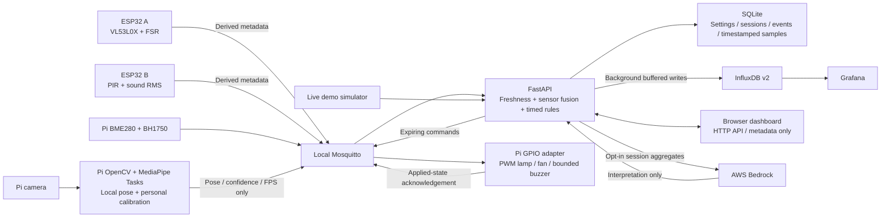

# FocusGuard implementation design

This is the concrete prototype architecture derived from the [source design](../FocusGuard_Privacy_Aware_Smart_Study_Desk.md). The software demo and physical desk use the same rules; only their input adapters differ.

## Why these choices

FastAPI keeps the decision engine, hardware adapters, evaluation, and optional AI integration in Python. A deterministic engine with an injected clock makes time-based behavior testable without sleeping or connecting devices. It also makes decisions easier to explain than a trained condition classifier. MediaPipe is used only for pretrained pose extraction; calibrated geometry determines posture.

The browser uses native JavaScript modules and SVG rather than a build framework. That keeps the dashboard immediately runnable on the available Python-only workstation and easy to serve from a Pi. Its data source is the API, not an embedded canned dataset. Session history and charts accumulate from actual simulator or hardware inputs after startup.

SQLite supplies durable local history when no additional services are running. The full deployment mirrors typed conditions and system events into InfluxDB for the required time-series/Grafana architecture. Influx writes and cloud requests run outside the control loop. SQLite remains available when those integrations are offline; the bounded Influx retry queue reports pending/dropped counts rather than hiding an outage.

## Boundaries and state

- **Demo versus hardware:** each observation, session, and event carries a mode. Database filters apply before record limits. Demo mode never publishes physical actuator commands. Switching modes ends the current session and clears previous sensor state.
- **Occupancy:** two independent presence signals establish occupancy. Fresh vision/seat/motion metadata is fused; stale readings become unknown. Temporary absence pauses a session after its grace interval, and prolonged inactivity ends it.
- **Session timing:** active desk time, continuous sitting time, screen time, and break duration are distinct. A completed movement break resets continuous sitting; an early return does not earn a full movement break. Manual pause does not reset continuous sitting.
- **Warnings:** abnormal conditions must persist for their configured duration. Reliable vision is required for posture alerts; distance and forward lean support fused too-close warnings. Cooldowns and short GPIO buzzer pulses prevent continuous beeping.
- **Actuation:** automatic lamp/fan decisions depend on presence and fresh environmental inputs. Manual overrides apply until automatic mode is restored or operating mode changes. GPIO checks command IDs and expiration; a watchdog drives outputs off when the rule service stops sending fresh commands.
- **Privacy:** the API only accepts explicitly allowed metadata fields and rejects media-like payloads. Camera previews and calibration stay local. AI uses a separate allowlisted aggregate object and never controls outputs.
- **Interpretation:** completed sessions receive a background summary. Without cloud consent and a configured provider, the summary is explicitly local. A provider failure cannot stop sensor monitoring.

The API is described in [backend/API.md](../backend/API.md). Calibration and wiring are in [HARDWARE.md](HARDWARE.md). Actual experimental limits and evidence requirements are in [evaluation/README.md](../evaluation/README.md).

## Scope of the running prototype

The default browser view demonstrates the control loop using live synthetic readings, including failures. The Pi and ESP32 programs are independent runnable integrations; they require the named hardware, model, drivers, and credentials. Docker Compose provisions the local services. A successful simulation or software test does not establish physical sensing performance or complete the course's real-world evaluation.

Multi-desk tenancy, identity/card hardware, notifications, OTA updates, a trained posture classifier, and cloud synchronization are future extensions listed by the source document. The prototype has one study workspace and configurable personal thresholds.
