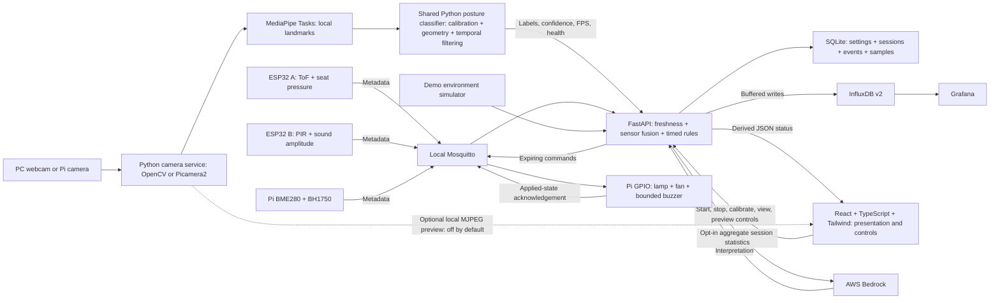

# FocusGuard implementation design

This prototype follows the [source design](../FocusGuard_Privacy_Aware_Smart_Study_Desk.md). Simulator and hardware inputs feed the same deterministic Python decision engine. Camera logic also has one Python implementation shared by the backend camera service and standalone Raspberry Pi gateway.

The standalone `raspberry_pi.gateway` is an alternative camera owner. It imports `backend.vision.posture` and sends the same derived vision metadata over MQTT. Run either direct-backend camera capture or gateway capture for one physical camera. Environment/GPIO adapters can run independently where configured.

## Runtime responsibilities

`backend/vision/service.py` owns camera capture, MediaPipe Tasks inference, monotonic video timestamps, calibration commands, classification, performance diagnostics and an optional in-memory preview. Its worker thread owns the native camera and model resources. Python's shared `backend/vision/posture.py` contains the accepted upper/full-body rules; there is no duplicated frontend classifier. A calibrated reference, confidence checks and temporal stabilization convert MediaPipe landmarks into the six FocusGuard labels.

The React frontend contains API types, controls and display formatting. It polls `/api/vision/status` every 500 ms while the camera panel is mounted, and sends explicit REST commands for start/stop/calibration/view/preview. It does not open a browser camera, execute inference or publish posture claims. It receives derived diagnostics without body landmark arrays. Preview is a separate, explicitly enabled MJPEG response with the skeleton drawn in Python.

The decision engine uses an injected clock to make sustained-duration rules, session accounting and staleness deterministic in tests. The camera adapter feeds observations into that engine in process. In demo mode it selects `pc_camera`; in hardware mode it feeds the `gateway` vision source alongside actual sensor metadata. Source or mode changes clear old evidence and separate session statistics.

Node.js 24 LTS and Vite 8 build React 19, strict TypeScript 6 and Tailwind CSS 4. TanStack Query manages server state; React Router handles navigation; Recharts shows trends; React Hook Form and Zod validate settings. FastAPI serves only `frontend/dist/` in production. Vite proxies API requests in development. Neither frontend builds nor runtime require MediaPipe browser SDK/WASM assets.

SQLite provides durable local history without extra services. The full stack mirrors derived conditions and events into InfluxDB/Grafana. Influx writes and cloud summaries run outside the control loop; outages do not replace known measurements with fabricated values. SQLite remains durable while the bounded in-memory Influx retry queue reports pending/dropped counts.

## Boundaries and state

- **Modes:** observations, sessions and events carry their mode. Demo never publishes physical actuator commands. Mode switching ends the current session, stops its camera owner and clears readings.
- **Demo camera:** real Python camera posture replaces generated vision; environment/ToF and outputs remain simulated. Simulated seat/motion evidence follows reliable camera presence. Stopped, uncalibrated, uncertain or stale camera data does not manufacture a healthy posture or an occupied desk. Simulation resumes only through explicit selection.
- **Capture ownership:** a camera started by the dashboard stops when that page is hidden or left. Merely observing a pre-existing headless camera does not give the browser ownership. Hardware-only `VISION_AUTOSTART` supports continuous Pi operation without a dashboard.
- **Occupancy:** fresh seat, camera and motion metadata is fused. Hardware occupancy needs agreeing independent signals; simulated presence is explicitly labeled. Temporary absence pauses after its grace interval, and prolonged absence ends the session.
- **Session timing:** active time, continuous sitting, screen time and break time have separate counters. A completed movement break resets continuous sitting; an early return does not earn a completed break.
- **Warnings:** sustained observed conditions and per-rule cooldowns govern reminders. Vision reliability gates posture alerts. Camera failure does not disable independent environmental sensing.
- **Actuation:** automatic lamp/fan actions require presence and fresh inputs. Manual overrides remain explicit. GPIO verifies command expiry and its watchdog turns outputs off when commands stop arriving.
- **Privacy:** input APIs reject image/audio/landmark payloads. Python retains inference frames/points only in memory. Normal dashboard JSON contains labels and derived geometry, with `landmarks: []`. Optional local MJPEG preview transmits images to the dashboard while enabled; no images are persisted or sent to Bedrock.
- **Debugging:** terminal INFO logs report camera lifecycle, actual delegate, calibration, posture transitions/reasons and rate-limited FPS/inference timings. DEBUG adds numerical derived geometry without media.
- **AI:** consent and configured credentials are required for cloud summaries. Only aggregate session statistics enter the prompt. Local fallback is labeled; model output never controls an actuator.

## Raspberry Pi 5 and verification

The Python classifier and camera service can move from a PC to the supported 64-bit Pi environment without moving logic back into React. OpenCV handles USB cameras; Picamera2 handles a configured CSI/libcamera stack. CPU is the default inference delegate. A Pi 5 GPU does not guarantee compatibility with the installed MediaPipe GPU delegate; attempted GPU initialization falls back to CPU and reports what actually runs. Measure throughput on the assembled target hardware.

The extracted screenshot fixture and `python -m evaluation.evaluate_pc_posture` preserve reproducible classifier regression checks. Frozen-landmark replay, native MediaPipe re-extraction, live webcam behavior and physical sensor performance are separate forms of evidence. Passing one does not establish the others.

See [API reference](../backend/API.md), [Python camera setup](PC_CAMERA.md), [hardware deployment](HARDWARE.md), [verification record](VERIFICATION.md) and [evaluation protocol](../evaluation/README.md). Multi-desk identity, notifications, OTA updates, cloud synchronization and a trained advanced classifier remain extensions. The prototype has one configurable study workspace.
